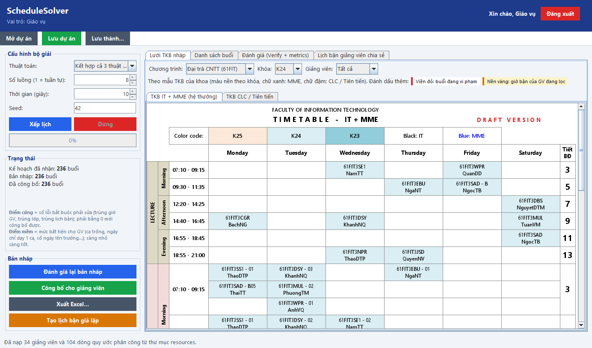
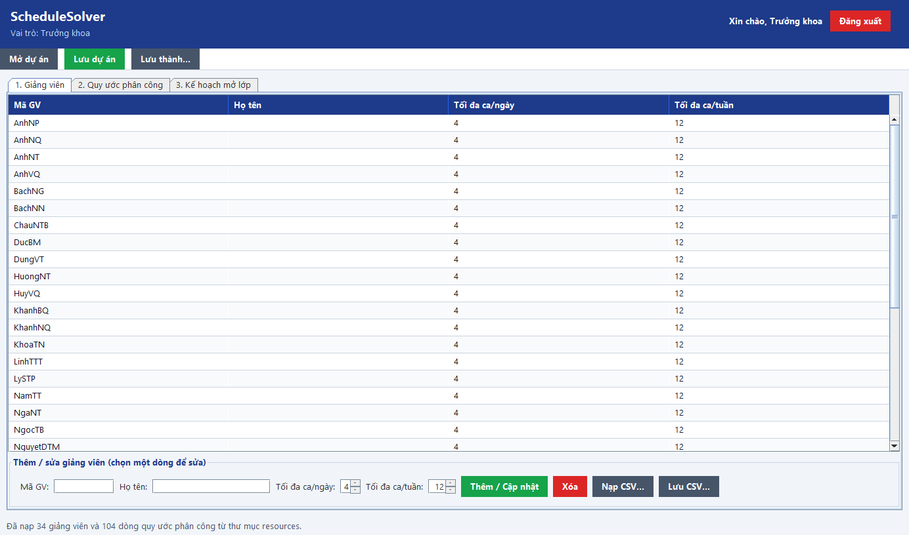
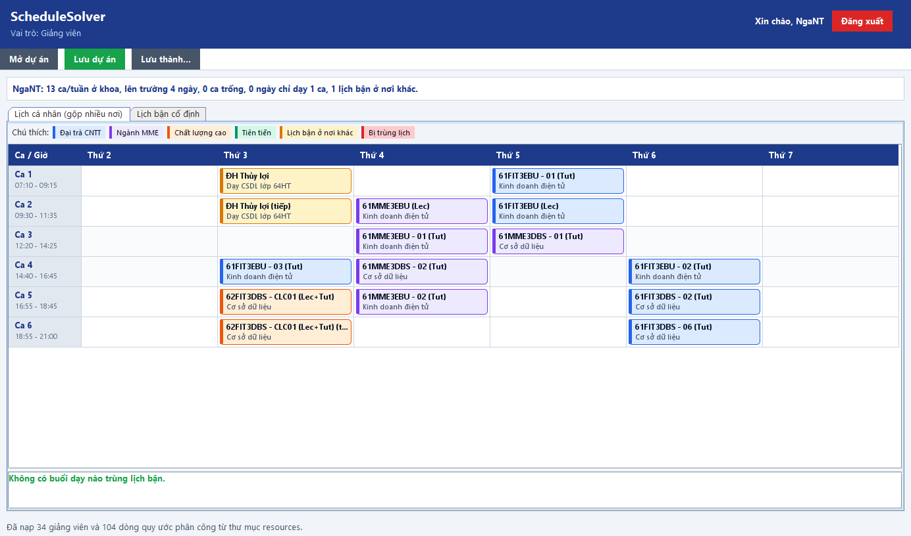

# ScheduleSolver 📅⚡

> **Ứng dụng tự động hóa phân công và xếp thời khóa biểu thông minh cho Khoa CNTT – Đại học Hà Nội (FIT–HANU).**

[](https://openjdk.org/)
[](https://maven.apache.org/)
[](https://docs.oracle.com/en/java/javase/21/docs/api/java.desktop/javax/swing/package-summary.html)
[](https://poi.apache.org/)
[](https://junit.org/junit5/)
[](#)

---

## 📖 Mô tả dự án (Description)

**ScheduleSolver** giải quyết triệt để bài toán xếp thời khóa biểu và phân công giảng viên vốn mất nhiều ngày khi làm thủ công trên Excel. Ứng dụng kết hợp các giải thuật tìm kiếm cục bộ (**Simulated Annealing, Tabu Search, Hill Climbing**) với bộ giải đa luồng song song (**Parallel Solver**), giúp tìm ra lịch học đạt **0 vi phạm cứng**, giảm tới **37% số ngày lên trường** và triệt tiêu toàn bộ ca trống chỉ trong vài giây.

---

## 🖼️ Ảnh giao diện (Preview)

| Đăng nhập theo vai trò | Màn hình Giáo vụ (Xếp lịch đa luồng) |
|:---:|:---:|
|  |  |

| Màn hình Trưởng khoa (Phân công) | Màn hình Giảng viên (Lịch gộp) |
|:---:|:---:|
|  |  |

---

## 📑 Mục lục (Table of Contents)

- [Điều kiện tiên quyết](#-điều-kiện-tiên-quyết-prerequisites)
- [Hướng dẫn cài đặt](#-hướng-dẫn-cài-đặt-installation)
- [Cách sử dụng](#-cách-sử-dụng-usage)
- [Công nghệ sử dụng](#-công-nghệ-sử-dụng-built-with)
- [Tài liệu chi tiết](#-tài-liệu-chi-tiết)

---

## ⚙️ Điều kiện tiên quyết (Prerequisites)

- **Java JDK**: 21 trở lên (hỗ trợ Java 21, 24).
- **Apache Maven**: 3.8 trở lên.
- **Git**.

---

## 📦 Hướng dẫn cài đặt (Installation)

```bash
# 1. Clone mã nguồn
git clone https://github.com/tanhlucky102/ScheduleSolver.git
cd ScheduleSolver

# 2. Đóng gói ứng dụng thành file JAR
mvn clean package -DskipTests
```

---

## 🚀 Cách sử dụng (Usage)

### 1. Khởi chạy ứng dụng
Chạy bằng một trong các lệnh sau:
- **Cách nhanh nhất**: `./run.sh`
- **Hoặc qua Maven**: `mvn exec:java`
- **Hoặc qua file JAR**: `java -jar target/schedulesolver.jar`

### 2. Tài khoản thử nghiệm (Mật khẩu mặc định: `123456`)
- **Trưởng khoa**: `truongkhoa` — Duyệt kế hoạch mở lớp, quy ước phân công.
- **Giáo vụ**: `giaovu` — Cấu hình & chạy bộ giải song song, chỉnh sửa TKB, xuất Excel.
- **Giảng viên**: `anhnp` (hoặc `chauntb`, `linhttt`,...) — Xem TKB, gộp lịch nhiều trường, gửi giờ bận.

### 3. Kiểm thử đơn vị (Unit Tests)
```bash
mvn test
```
*(44/44 test cases kiểm thử giải thuật, tính điểm Delta và I/O Excel).*

---

## 🛠️ Công nghệ sử dụng (Built With)

- **Nền tảng & Giao diện:** Java 21 LTS, Java Swing (Modern Flat UI).
- **Xử lý Excel:** Apache POI 5.2.5 (đọc kế hoạch mở lớp & xuất TKB mẫu FIT-HANU).
- **Kiểm thử:** JUnit 5 (Jupiter 5.10.2).
- **Giải thuật tối ưu hóa:** Tham lam (Greedy), Leo đồi (Hill Climbing), Tôi luyện thép (Simulated Annealing), Tìm kiếm Tabu (Tabu Search).
- **Kiến trúc song song:** Bộ giải chạy đa luồng (`ParallelSolver`) kết hợp tính điểm vi phân $O(1)$ (`Delta Scoring`) tăng tốc độ đánh giá ~37 lần.

---

## 📄 Tài liệu chi tiết

- 📑 [Tóm tắt nghiệp vụ & bài toán](docs/PROJECT_BREIF.md)
- 📐 [Giải thuật, metrics & kiến trúc đa luồng](docs/GIAI_THUAT_VA_METRICS.md)
- 📈 [Báo cáo kết quả thực nghiệm chi tiết](docs/results/KET_QUA_THUC_NGHIEM.md)
- 📋 [Đặc tả yêu cầu phần mềm (SRS)](docs/srs/functional-requirements/_index.md)
