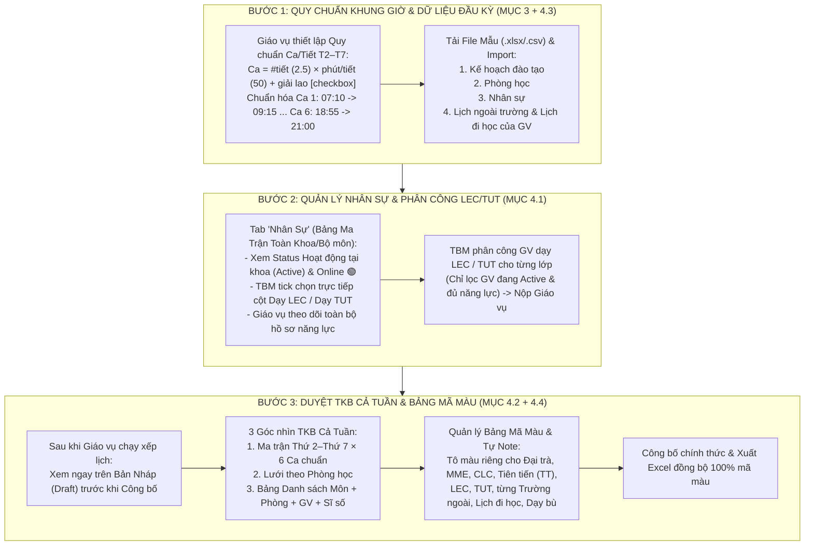

# TÀI LIỆU TRIỂN KHAI RIÊNG: MỤC 3 & MỤC 4 (PHẦN VIỆC ĐƯỢC GIAO)
**Stack triển khai**: Python (FastAPI + Pydantic + OpenPyXL) & Next.js (React + TypeScript)

---

## TỔNG QUAN PHẠM VI ĐƯỢC GIAO (TÁCH ĐỘC LẬP VỚI CÁC MỤC KHÁC)

Bạn phụ trách trọn gói **Mục 3** và **Mục 4**, không đụng chạm hay gây xung đột với người làm Mục 1 (Thuật toán lõi) và Mục 2 (TCP Socket / Socket.IO):
1. **MỤC 3 — Khung giờ, Ca học & Quy định Học kỳ (HANU 2.5 Tiết)**:
   - Quy chuẩn Ca học thống nhất từ **Thứ 2 $\to$ Thứ 7** (bắt đầu chuẩn `07:10 -> 09:15`, tránh phân rã lặp lại 66 dòng rời rạc, sửa lỗi chồng 5 phút `16:40` vs `16:45`).
   - Đồng bộ thời gian giữa **Ca** và **Tiết**, hỗ trợ **ca 2.5 tiết của HANU** (`float`), công thức chuẩn có **Checkbox giải lao**:
     $$\text{Thời lượng Ca} = \text{round}(\text{Số tiết} \times \text{Phút mỗi tiết}) + (\text{Checkbox Giải lao} \ ? \ \text{Phút giải lao} : 0)$$
   - Giáo vụ điều chỉnh giờ bắt đầu Tiết 1 + thời gian nghỉ chuyển ca $\implies$ tự động suy ra giờ bắt đầu/kết thúc của các ca trong ngày.
2. **MỤC 4 — Nghiệp vụ Actor, Module "Nhân Sự", Xem TKB Cả Tuần, Hệ thống File Mẫu Import & Quản lý Bảng Mã Màu**:
   - **4.1. Module "Nhân Sự" (Hồ sơ năng lực GV)**: Đổi tên thành **Nhân Sự**; hiển thị toàn bộ danh sách nhân sự trên 1 bảng ma trận (**không bắt chọn từng người qua dropdown**); có **Status hoạt động tại khoa (`active`)** và **Status trực tuyến (`online`)**; Trưởng bộ môn tick sửa trực tiếp `ai dạy LEC / ai dạy TUT`, Giáo vụ xem được toàn khoa.
   - **4.2. Xem TKB Cả Tuần & Danh sách Môn/Phòng ngay sau khi Giáo vụ xếp lịch**: Xem ngay trên **Bản Nháp (`draft`)** trước khi công bố, gồm đủ 3 góc nhìn: `Ma trận Thứ × Ca`, `Lưới Theo Phòng`, và `Bảng Danh sách Môn học đã xếp` (môn, nhóm, Lec/Tut, phòng học, giảng viên, sĩ số, ca/tiết).
   - **4.3. Hệ thống File Mẫu (Template) & Import Lịch ngoài trường / Lịch đi học**: Mọi chỗ Import (Kế hoạch đào tạo, Lịch ngoài trường/Đi học, Nhân sự, Phòng học) đều có **Nút tải File mẫu chuẩn + Xem trước cấu trúc cột**; mở khóa cho phép Import Lịch ngoài trường & Lịch đi học thay vì nhập tay từng dòng.
   - **4.4. Quản lý Bảng Mã Màu & Tự Note theo sở thích**: Bảng màu tùy chỉnh cho Chương trình (`Đại trà`, `MME`, `CLC`, tách riêng `TT Tiên tiến`), Loại buổi (`LEC`, `TUT`, `COMBINED`), Trường ngoài, Lịch đi học, Dạy bù, Trùng lịch + tự thêm màu & viết ghi chú (`note`) đồng bộ cả trên Web lẫn xuất Excel.

---

## CHI TIẾT CÁC ĐẦU VIỆC CỤ THỂ & CÁCH LÀM TRONG CODE

### PHẦN A: MỤC 3 — SỬA KHUNG GIỜ, CA HỌC & TIẾT HỌC (HANU 2.5 TIẾT)

| Hạng mục | File cần sửa / tạo | Nội dung thay đổi chi tiết |
|---|---|---|
| **3.1. Cho phép số tiết thập phân (`2.5` tiết) & Checkbox giải lao ở Backend** | - `backend/app/timetable/models.py` - `backend/app/timetable/rules.py` - `backend/app/planning/importer.py` | 1. Trong `models.py`:    - Đổi `Offering.lecture_periods`, `Offering.tutorial_periods`, `Session.periods` từ `int` sang `float` (cho phép `2.5` tiết).    - Trong `Config`, thêm:      + `include_break: bool = True` (cờ checkbox cộng giải lao).      + `first_period_start: int = 430` (`07:10` — giờ bắt đầu Tiết 1 do Giáo vụ đặt).      + `active_days: list[int] = [2, 3, 4, 5, 6, 7]` (áp dụng đồng nhất Thứ 2 $\to$ Thứ 7).      + `shift_templates: list[ShiftTemplate]` (lưu quy chuẩn ca trong ngày, không phân rã lặp lại từng ngày). 2. Trong `rules.py`:    - Cập nhật hàm `duration(s, c)`:      - Nếu `c.include_break == False`: `round(s.periods * c.period_minutes)` (Ví dụ HANU: `2.5 * 50 = 125` phút $\implies$ `07:10` đến `09:15`).      - Nếu `c.include_break == True`: `round(s.periods * c.period_minutes + max(0, ceil(s.periods) - 1) * c.break_minutes)`. 3. Trong `importer.py`:    - Đổi `int(...)` sang `float(...)` khi đọc cột `Số tiết Lec` / `Số tiết Tut` từ file Excel kế hoạch. |
| **3.2. Giao diện Quy chuẩn Ca & Đồng bộ Tiết (Thứ 2 $\to$ Thứ 7)** | - `frontend/features/scheduling/config-editor.tsx` - `frontend/features/scheduling/term-calendar-model.ts` | 1. Trong `config-editor.tsx`:    - Thêm khu vực **Quy chuẩn Ca học chung trong ngày (Áp dụng đồng nhất T2–T7)**:      + Ô nhập `Giờ bắt đầu Tiết 1` (mặc định `07:10`), `Số tiết chuẩn mỗi ca` (ví dụ `2.5`), `Phút mỗi tiết` (`50`), **Checkbox `Cộng giờ giải lao trong ca`** + `Số phút giải lao`, và `Nghỉ chuyển ca` (`15` phút).      + Hiển thị trực tiếp công thức kiểm chứng: `1 Ca = 2.5 tiết × 50 phút + 0p giải lao = 125 phút (Ca 1: 07:10 → 09:15)`.      + Bảng 6 Ca chuẩn (`Sáng 1: 07:10–09:15 [Tiết 1–3]`, `Sáng 2: 09:30–11:35 [Tiết 4–6]`, `Chiều 1: 12:20–14:25 [Tiết 7–9]`, `Chiều 2: 14:40–16:45 [Tiết 10–12]`, `Chiều muộn: 16:55–18:45 [Tiết 13–14]`, `Tối: 18:55–21:00 [Tiết 15–16]`) + dãy checkbox chọn ngày áp dụng (`Thứ 2 .. Thứ 7`).      + Khi lưu, tự động nhân bản quy chuẩn ca sang `slots` của các ngày đã tick mà người dùng không phải sửa 36–66 dòng lặp lại. 2. Trong `term-calendar-model.ts`:    - Sửa lỗi chồng 5 phút của Ca 5 (`E1`) từ `16:40` (`1000`) thành **`16:55` (`1015`)** và hỗ trợ sinh hàng ca động từ `config` của học kỳ. |

---

### PHẦN B: MỤC 4 — MODULE NHÂN SỰ, XEM TKB TUẦN, IMPORT MẪU, BẢNG MÀU & LUỒNG ACTOR

| Hạng mục | File cần sửa / tạo | Nội dung thay đổi chi tiết |
|---|---|---|
| **4.1. Module "Nhân Sự" (Hồ sơ năng lực GV, không chọn từng người, có Status Active & Online)** | - `backend/app/timetable/models.py` - `backend/app/timetable/rules.py` - `backend/app/workspace/visibility.py` - `backend/app/assignments/commands.py` - `backend/app/assignments/schemas.py` - `backend/app/catalog/commands.py` - `frontend/features/assignments/personnel-matrix.tsx` *(Mới)* - `frontend/app/page.tsx` | 1. **Backend**:    - Thêm `active: bool = True` vào `Teacher` (`timetable/models.py`). Trong `rules.py:eligible`, kiểm tra `t.active` để không xếp lớp cho GV tạm nghỉ.    - Trong `visibility.py`: Ghi nhận trạng thái hoạt động phiên làm việc (`online_users` / `online_teachers`) trả kèm ngoài `state`; sửa lọc `teachers` của `HEAD` để không bị mất GV liên bộ môn.    - Trong `assignments/commands.py`: Cho phép `HEAD` cập nhật hồ sơ năng lực (`action == "teacher"`) bất kể trạng thái bộ môn (`UNSENT`/`SENT`/`SUBMITTED`), hỗ trợ cập nhật cả `active`, `assistant`, `capabilities`. 2. **Frontend**:    - Đổi tên tab điều hướng trên Sidebar (`page.tsx`) thành **"Nhân Sự"**.    - Xây dựng `PersonnelMatrix`: Bảng danh sách toàn bộ nhân sự hiển thị trực tiếp `Mã GV`, `Họ tên`, `Bộ môn`, `Status Khoa (Đang hoạt động / Tạm nghỉ)`, `Status Online (🟢 Online / ⚪ Offline)`, `Tải giảng dạy`, và **Cột Ma trận Năng lực (`[✓ LEC]` / `[✓ TUT]` cho từng môn)**.    - TBM tick trực tiếp trên bảng (không cần chọn từng người qua dropdown `<select>`); Giáo vụ xem toàn bộ hồ sơ năng lực của mọi bộ môn. |
| **4.2. Xem TKB Cả Tuần & Danh sách Môn/Phòng ngay sau khi Giáo vụ xếp lịch** | - `frontend/features/scheduling/term-calendar.tsx` - `frontend/features/scheduling/draft-schedule.tsx` - `frontend/app/page.tsx` | 1. Xây dựng helper chuyển đổi `state.draft` + `state.sessions` + `state.config.slots` thành mảng `draftEvents` đầy đủ thông tin. 2. Trên `TermCalendar`:    - Thêm thanh chọn nguồn lịch: **`📝 TKB Bản Nháp (Vừa xếp)`** $\leftrightarrow$ **`✅ TKB Chính Thức (Đã công bố)`**.    - Bổ sung chế độ xem thứ 3: **`📋 Danh sách môn học đã xếp`** (hiển thị bảng đầy đủ: `Mã MH`, `Tên môn`, `Khóa`, `Nhóm`, `Loại LEC/TUT`, `Số tiết`, `Thứ`, `Ca/Tiết`, `Khung giờ`, `Phòng học`, `Giảng viên`, `Sĩ số`). 3. Trên `DraftSchedule`: Nhúng nút mở thẳng sang Lưới TKB Cả Tuần Bản Nháp + khung xem nhanh TKB tuần ngay sau khi chạy Solver xong. |
| **4.3. Hệ thống File Mẫu (Template) & Import Lịch ngoài trường / Lịch đi học** | - `backend/app/templates.py` *(Mới)* - `backend/app/planning/api.py` - `backend/app/timetable/models.py` - `backend/app/timetable/publication.py` - `backend/app/timetable/rules.py` - `backend/app/scheduling/commands.py` - `frontend/features/scheduling/personal-schedule.tsx` - `frontend/features/workspace/plan-import-card.tsx` - `frontend/features/catalog/catalog-import.tsx` - `frontend/features/rooms/room-manager.tsx` | 1. **Tạo API tải File mẫu `GET /api/templates/{kind}`** (`plan`, `external`, `teachers`, `rooms`) xuất file `.xlsx` / `.csv` chuẩn có dòng ví dụ thực tế. 2. Mở rộng `External` (`models.py`) thêm `activity_type` (`EXTERNAL_TEACHING` Dạy ngoài, `STUDYING` Đi học, `PERSONAL_BUSY` Bận cá nhân, `MAKEUP` Dạy bù), `color`, `note`. 3. Bỏ điều kiện bắt buộc `if not state.published` trong `publication.py:add_external` để GV import lịch ngoài / lịch đi học ngay từ đầu kỳ; thêm kiểm tra `External overlap` trong `rules.py:evaluate` để Solver tự động tránh giờ dạy ngoài / giờ đi học của GV. 4. Thêm action `external-import` nạp hàng loạt buổi từ file Excel/CSV trên `PersonalSchedule` + thêm nút **📥 Tải File Mẫu** và **Bảng xem trước cột mẫu** ở cả 4 màn hình Import. |
| **4.4. Quản lý Bảng Mã Màu & Tự Note theo sở thích** | - `backend/app/timetable/models.py` - `backend/app/timetable/exporter.py` - `frontend/features/scheduling/color-palette-manager.tsx` *(Mới)* - `frontend/features/scheduling/term-calendar-model.ts` - `frontend/features/scheduling/term-class-card.tsx` - `frontend/features/scheduling/personal-calendar.tsx` | 1. Thêm `ColorRule` vào `Config.color_rules` lưu màu nền, màu chữ và `note` tùy chỉnh. 2. Tách riêng hệ **Tiên tiến (`TT` / `66FIT`)** thành nhóm màu riêng (Xanh ngọc `#d1fae5`), không gom nhầm vào Đại trà; hiển thị rõ badge màu `LEC` / `TUT` / `LT+TH` trên thẻ lớp `ClassCard` và file Excel xuất ra (`exporter.py`). 3. Tạo bộ `ColorPaletteManager` cho phép chọn màu bằng Color Picker, thêm nhãn màu mới (cho từng Trường ngoài, Đi học, Dạy bù, Lec, Tut...) và tự gõ Note theo sở thích. |

---

## FLOWCHART LUỒNG NGHIỆP VỤ CỦA MỤC 3 & MỤC 4 (ĐỂ ĐƯA VÀO BÁO CÁO PHẦN CỦA BẠN)

