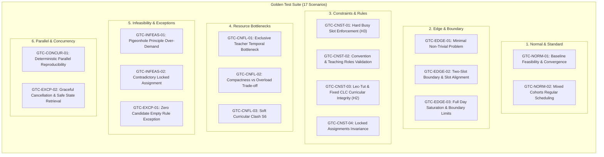

# Bộ kiểm thử chuẩn (Golden Test Suite Specification)

Tài liệu này lưu trữ đặc tả chi tiết và tiêu chí nghiệm thu của **17 kịch bản kiểm thử chuẩn (Golden Test Scenarios)** dành cho bộ giải tối ưu hóa thời khóa biểu khoa CNTT – Đại học Hà Nội ([`ScheduleSolver`](../../README.md)).

Dữ liệu JSON kết quả thực thi kiểm thử được lưu tại: [`golden_test_results.json`](golden_test_results.json)  
Mã nguồn thực thi và đánh giá tự động: [`GoldenTestRunner.java`](../../src/test/java/vn/edu/fit/schedulesolver/solver/GoldenTestRunner.java)

---

## 1. Phân loại kịch bản kiểm thử



---

## 2. Chi tiết đặc tả từng kịch bản

### `GTC-NORM-01`: Baseline Feasibility & Convergence
- **Phân loại:** `normal`
- **Mục tiêu:** Xác minh bộ giải tìm được lịch học khả thi ($H=0$) trên tập dữ liệu chuẩn mực, không có mâu thuẫn cấu trúc.
- **Đầu vào:** 3 GV, 6 buổi học K24 (Lec, Tut, CLC 2 ca), mỗi buổi có ít nhất 2 GV ứng viên.
- **Kỳ vọng:** Lời giải đạt $H = 0$, 100% buổi được xếp, buổi 2 ca bắt đầu ở slot chẵn $\{0, 2, 4\}$.
- **Tiêu chí nghiệm thu:** `score.getHard() == 0`, `violations.isEmpty() == true`.

### `GTC-NORM-02`: Mixed Cohorts Regular Scheduling
- **Phân loại:** `normal`
- **Mục tiêu:** Đánh giá khả năng tối ưu hóa đa mục tiêu khi nhiều khóa (K23, K24, K25) chia sẻ tài nguyên GV.
- **Đầu vào:** 5 GV, 18 buổi học (6 buổi mỗi khóa), không có lịch bận cố định.
- **Kỳ vọng:** Đạt $H = 0$, tối ưu hóa cục bộ giảm điểm phạt mềm $S$ so với Greedy ban đầu $\ge 30\%$.
- **Tiêu chí nghiệm thu:** `score.getHard() == 0`, $S_{best} < S_{initial}$.

### `GTC-EDGE-01`: Minimal Non-Trivial Problem
- **Phân loại:** `edge`
- **Mục tiêu:** Kiểm chứng thuật toán chạy chính xác tại điều kiện biên cực tiểu (1 buổi, 1 GV).
- **Đầu vào:** 1 GV, 1 buổi học 1 ca, 1 ứng viên, không có lịch bận.
- **Kỳ vọng:** $H = 0$, điểm phạt mềm chính xác theo lý thuyết: $S = 5 \text{ (ngày lên trường)} + 15 \text{ (ngày 1 ca)} = 20$.
- **Tiêu chí nghiệm thu:** `score.getHard() == 0`, `score.getSoft() == 20`.

### `GTC-EDGE-02`: Two-Slot Boundary & Slot Alignment
- **Phân loại:** `edge`
- **Mục tiêu:** Xác minh bộ giải không xếp buổi 2 ca ở slot lẻ $\{1, 3, 5\}$ hoặc vắt qua ca cuối ngày.
- **Đầu vào:** 1 GV, 3 buổi 2 ca; Thứ 2 bận ca 1–4 (slot 0..3), chỉ rảnh ca 5–6 (slot 4, 5); Thứ 4–7 bận cả ngày; Thứ 3 rảnh.
- **Kỳ vọng:** Buổi ở Thứ 2 bắt buộc rơi vào `slot 4`. Tất cả các buổi 2 ca có `slot % 2 == 0`.
- **Tiêu chí nghiệm thu:** `TimeSlots.isValidStart(sol.getSlot(i), 2) == true`, $H = 0$.

### `GTC-EDGE-03`: Full Day Saturation & Boundary Limits
- **Phân loại:** `edge`
- **Mục tiêu:** Kiểm chứng thuật toán khi 1 GV dạy kín cả 6 ca trong 1 ngày duy nhất (Thứ 2).
- **Đầu vào:** 1 GV (max 4 ca/ngày), 6 buổi 1 ca, bận toàn bộ Thứ 3–7.
- **Kỳ vọng:** $H = 0$. Thứ 2 kín 6 ca liên tục. Phạt mềm: $S = 5 \text{ (1 ngày)} + (6 - 4) \times 20 \text{ (vượt ngày)} = 45$.
- **Tiêu chí nghiệm thu:** `score.getHard() == 0`, `score.getSoft() == 45`, `DayMask.countGaps == 0`.

### `GTC-CNST-01`: Hard Busy Slot Enforcement (H3)
- **Phân loại:** `constraint`
- **Mục tiêu:** Không xếp trùng vào khung giờ bận trường ngoài của GV phụ trách.
- **Đầu vào:** GV0 bận Thứ 2 (ca 1-2), Thứ 4 (ca 3-4), Thứ 6 (ca 5-6). 8 buổi học do GV0 phụ trách.
- **Kỳ vọng:** 0 buổi nào trùng giờ bận.
- **Tiêu chí nghiệm thu:** `ScoreCalculator.busyCost() == 0`, $H = 0$.

### `GTC-CNST-02`: Convention Enforcement
- **Phân loại:** `constraint`
- **Mục tiêu:** Phân công đúng thẩm quyền Lecture / Tutorial theo quy ước.
- **Đầu vào:** Môn `61FIT3OOP`: GV_LEC chỉ dạy Lec, GV_TUT chỉ dạy Tut.
- **Kỳ vọng:** Buổi Lec do GV_LEC dạy, buổi Tut do GV_TUT dạy.
- **Tiêu chí nghiệm thu:** Khớp mã GV chính xác, không vi phạm `RULE_NOT_ALLOWED`.

### `GTC-CNST-03`: Curricular Integrity (H2)
- **Phân loại:** `constraint`
- **Mục tiêu:** Phân loại đúng xung đột cứng vs mềm: Lec và Tut cùng lớp là cứng; khác lớp là hợp lệ; CLC cố định là cứng; TT linh hoạt là hợp lệ.
- **Đầu vào:** 7 buổi học bao gồm đại trà (A vs A01 vs B01), CLC01, và TT01.
- **Kỳ vọng:** Khớp ma trận xung đột và xếp được lịch khả thi $H = 0$.
- **Tiêu chí nghiệm thu:** Khớp các hằng số `HARD_CONFLICT` và `NO_CONFLICT`.

### `GTC-CNST-04`: Locked Assignments Invariance
- **Phân loại:** `constraint`
- **Mục tiêu:** Buổi bị khóa bởi giáo vụ giữ nguyên 100% thời gian và GV trong suốt quá trình tối ưu.
- **Đầu vào:** 10 buổi học, buổi 0 bị khóa tại GV1, Thứ 3, Ca 1 (`slot 0`).
- **Kỳ vọng:** Sau 30.000 bước tìm kiếm, buổi 0 vẫn giữ nguyên tọa độ cũ.
- **Tiêu chí nghiệm thu:** `teacher == GV1`, `day == 3`, `slot == 0`.

### `GTC-CNFL-01`: Exclusive Teacher Bottleneck
- **Phân loại:** `conflict`
- **Mục tiêu:** Giải quyết tranh chấp tài nguyên khi 1 GV duy nhất phụ trách 12 buổi học.
- **Đầu vào:** 1 GV chuyên gia, 12 buổi học độc quyền.
- **Kỳ vọng:** Tự động rải đều vào 12 slot tách biệt, không trùng giờ ($H1 = 0$).
- **Tiêu chí nghiệm thu:** Không có cặp buổi nào giao nhau về thời gian, $H = 0$.

### `GTC-CNFL-02`: Compactness vs Overload Trade-off
- **Phân loại:** `normal`
- **Mục tiêu:** Tránh dồn lịch quá mức dẫn đến vượt tải ngày/tuần ($S_4, S_5$).
- **Đầu vào:** 2 GV (max 3 ca/ngày, 6 ca/tuần), 10 buổi học cả 2 GV đều dạy được.
- **Kỳ vọng:** Bộ giải tự chia đều 5 buổi cho mỗi GV, không ngày nào quá 3 ca.
- **Tiêu chí nghiệm thu:** `weekSlots <= 6`, `maxDaySlots <= 3`.

### `GTC-CNFL-03`: Soft Curricular Clash S6
- **Phân loại:** `constraint`
- **Mục tiêu:** Chủ động tách 2 Lecture khác môn cùng khóa để giảm phạt mềm $S_6$ (trọng số 20).
- **Đầu vào:** 2 Lecture cùng khóa K24, 2 GV khác nhau.
- **Kỳ vọng:** Bộ giải xếp vào 2 ca khác nhau để đạt $S_6 = 0$.
- **Tiêu chí nghiệm thu:** `overlaps == false`, $H = 0$.

### `GTC-INFEAS-01`: Pigeonhole Principle Over-Demand
- **Phân loại:** `infeasible`
- **Mục tiêu:** Kiểm chứng bài toán bất khả thi toán học: 35 buổi yêu cầu nhưng chỉ có 31 slot rảnh.
- **Đầu vào:** 1 GV bận 5 slot (còn 31 slot), cần xếp 35 buổi học.
- **Kỳ vọng:** Thuật toán dừng bình thường, phát hiện bài toán không khả thi ($H \ge 4$).
- **Tiêu chí nghiệm thu:** `isFeasible == false`, `hard_score >= 4`.

### `GTC-INFEAS-02`: Contradictory Locked Assignments
- **Phân loại:** `infeasible`
- **Mục tiêu:** Xử lý an toàn khi giáo vụ khóa 2 buổi trùng nhau về GV và thời gian.
- **Đầu vào:** Buổi A và Buổi B đều khóa tại GV0, Thứ 2, Ca 1 (`slot 0`).
- **Kỳ vọng:** Xác định không khả thi, ghi nhận lỗi `RULE_TEACHER_CLASH`.
- **Tiêu chí nghiệm thu:** `isFeasible == false`, `hard_score >= 1`, báo đúng lỗi trùng GV.

### `GTC-EXCP-01`: Zero Candidate Empty Rule Exception
- **Phân loại:** `exceptional`
- **Mục tiêu:** Phòng vệ dữ liệu khi tồn tại môn học chưa có quy ước phân công.
- **Đầu vào:** Buổi học `61FIT3SPECIAL-LEC` có danh sách ứng viên rỗng.
- **Kỳ vọng:** Ném `IllegalStateException` chỉ rõ mã buổi học, không crash ngầm.
- **Tiêu chí nghiệm thu:** Bắt được ngoại lệ với message chứa `61FIT3SPECIAL-LEC`.

### `GTC-CONCUR-01`: Deterministic Parallel Reproducibility
- **Phân loại:** `edge`
- **Mục tiêu:** Đảm bảo kết quả đa luồng đồng nhất 100% khi cố định seed và số vòng lặp.
- **Đầu vào:** Bài toán 50 buổi, chạy 2 lần độc lập với 4 luồng, seed 999, 10.000 iters/luồng.
- **Kỳ vọng:** Điểm số và ma trận phân công của 2 lần chạy trùng khớp bit-for-bit.
- **Tiêu chí nghiệm thu:** `bestScore1 == bestScore2`, `sol1.sameAs(sol2) == true`.

### `GTC-EXCP-02`: Graceful Cancellation & Safe State Retrieval
- **Phân loại:** `exceptional`
- **Mục tiêu:** Dừng an toàn khi người dùng bấm Stop, thu hồi nghiệm `best-so-far` nguyên vẹn.
- **Đầu vào:** Chạy 4 luồng timeout 60 giây, sau 200 ms gửi lệnh `requestStop()`.
- **Kỳ vọng:** Dừng trong $< 1500$ ms, cờ `isStoppedByUser == true`, nghiệm không bị null hoặc corrupt.
- **Tiêu chí nghiệm thu:** Thời gian dừng $< 1500$ ms, nghiệm thu hồi khớp điểm chấm lại.

---

## 3. Cách chạy lại kiểm thử tự động

Bạn có thể chạy toàn bộ bộ kiểm thử này và xuất lại file JSON bất kỳ lúc nào bằng lệnh:

```bash
# Biên dịch và chạy bộ test runner
java -cp target/test-classes:target/classes vn.edu.fit.schedulesolver.solver.GoldenTestRunner > docs/golden-tests/golden_test_results.json
```
