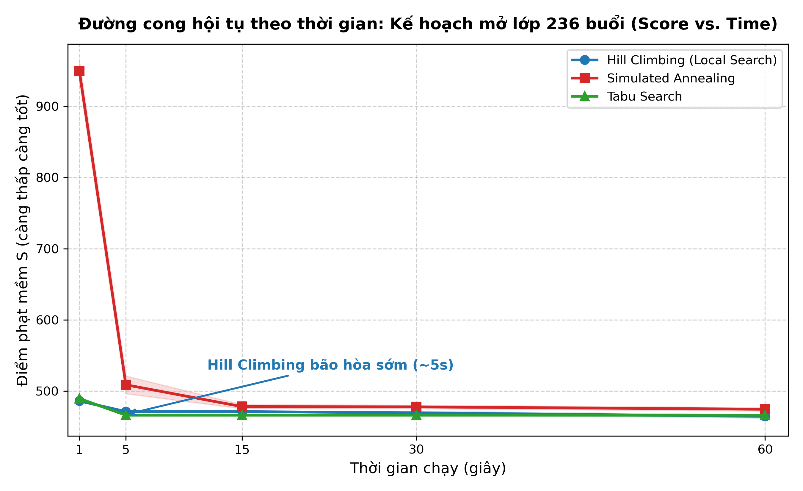
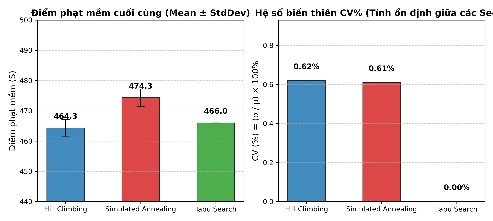
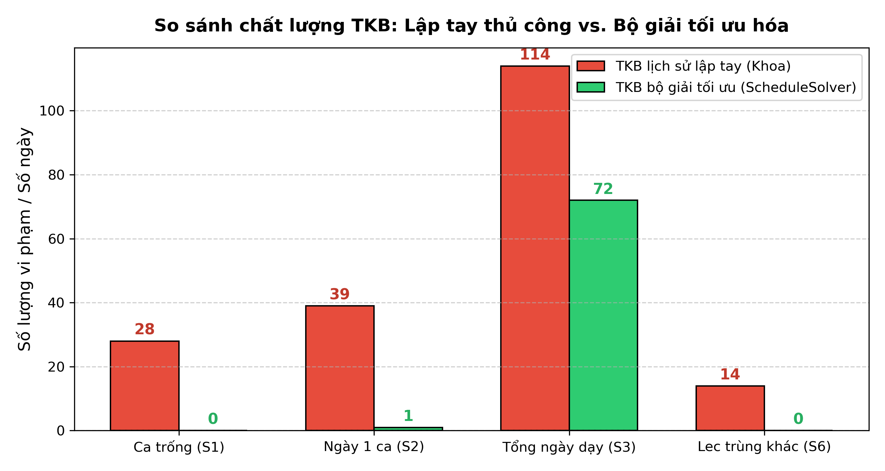
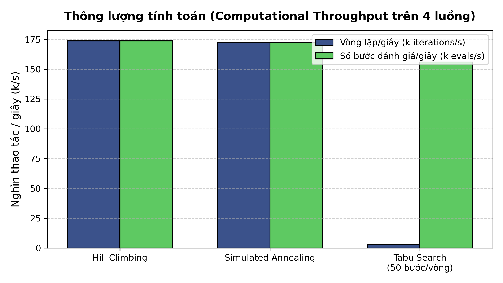

# Báo cáo Nghiên cứu Thực nghiệm: Đánh giá Mô hình Giải thuật (60 giây)

Tài liệu này lưu trữ kết quả thực nghiệm chi tiết về **độ trễ (latency), động lực học thời gian (score vs. time trong 1 phút), tính ổn định (stability & coefficient of variation)** và so sánh giữa 3 mô hình giải thuật tìm kiếm cục bộ cơ sở: **Hill Climbing (Leo đồi), Simulated Annealing (Mô phỏng luyện kim), Tabu Search (Tìm kiếm cấm)**.

Dữ liệu JSON gốc xuất từ bộ kiểm thử: [`algorithm_benchmark_results.json`](algorithm_benchmark_results.json)  
Thư mục chứa biểu đồ NCKH (300 DPI): [`figures/`](figures/)  
Script tự động sinh biểu đồ: [`figures/generate_figures.py`](figures/generate_figures.py)  
Mã nguồn thực thi benchmark: [`AlgorithmBenchmarkRunner.java`](../../src/main/java/vn/edu/fit/schedulesolver/experiment/AlgorithmBenchmarkRunner.java)

---

## 1. Môi trường thực nghiệm & Nguồn dữ liệu

* **Hệ điều hành:** Linux 7.0.0-38-generic (amd64)
* **Phần cứng:** 8 CPU cores vật lý/logic, 15 GB RAM (JVM cấp phát tối đa 4.096 MB)
* **Phiên bản Java:** OpenJDK 24.0.2
* **Nguồn dữ liệu:**
  - File Excel thực tế của khoa: [`FIT Time table Fall2026 V5.2.xlsx`](../../resources/FIT%20Time%20table%20Fall2026%20V5.2.xlsx)
  - Quy mô kế hoạch: 290 dòng Excel $\to$ **236 buổi học**, **35 giảng viên**
  - Quy ước phân công: [`quy_uoc_phan_cong.csv`](../../resources/quy_uoc_phan_cong.csv) (105 quy tắc)
  - TKB lịch sử lập tay: 246 ô lưới $\to$ **190 buổi học**
  - Lịch bận trường ngoài thực tế: [`lich_truong_khac.csv`](../../resources/lich_truong_khac.csv) (22 ca bận tại ĐH Thủy Lợi, PTIT, NEU)

---

## 2. Kịch bản `SCN-REAL-01`: Động lực học thời gian 60 giây & Tính ổn định

Bài toán gồm toàn bộ **236 buổi học**, 35 giảng viên, tỷ lệ bận giả định $30\%$ (seed 2026).  
Mỗi thuật toán chạy **4 luồng song song**, lặp lại qua **3 seed độc lập**, thời lượng **60 giây/lần chạy (1 phút)**.  
Điểm khởi tạo ban đầu từ thuật toán Tham lam (Greedy): **$H = 0$, $S = 1537$**.

### 2.1 Bảng tiến triển điểm mềm theo thời gian (Score vs. Time qua các mốc 1s $\to$ 60s)

| Mô hình giải thuật | Điểm 1s ($\mu \pm \sigma$) | Điểm 5s ($\mu \pm \sigma$) | Điểm 15s ($\mu \pm \sigma$) | Điểm 30s ($\mu \pm \sigma$) | Điểm 60s ($\mu \pm \sigma$) | Tốt nhất (Min) |
|---|---|---|---|---|---|---|
| **Hill Climbing (Leo đồi)** | $486.0 \pm 0.0$ | $471.0 \pm 0.0$ | $471.0 \pm 0.0$ | $469.3 \pm 2.89$ | **$464.3 \pm 2.89$** | **461** |
| **Simulated Annealing** | $949.3 \pm 16.3$ | $508.7 \pm 15.3$ | $478.0 \pm 3.46$ | $477.7 \pm 2.89$ | **$474.3 \pm 2.89$** | 471 |
| **Tabu Search** | $489.3 \pm 2.89$ | $466.0 \pm 0.0$ | $466.0 \pm 0.0$ | $466.0 \pm 0.0$ | **$466.0 \pm 0.0$** | **466** |

---

### 2.2 Bảng phân tích tính ổn định & Hệ số biến thiên ($CV\%$)

Hệ số biến thiên được tính theo công thức:
$$CV = \frac{\sigma}{\mu} \times 100\%$$

| Thuật toán | Điểm TB 60s ($\mu$) | Độ lệch chuẩn ($\sigma$) | Khoảng Range ($\text{Max}-\text{Min}$) | Hệ số biến thiên ($CV\%$) | Đánh giá tính ổn định |
|---|---|---|---|---|---|
| **Tabu Search** | **466.0** | **0.00** | **0.0** | **0.00%** | **Tất định tuyệt đối** (3/3 seed hội tụ chính xác 466) |
| **Simulated Annealing** | 474.3 | 2.89 | 5.0 | **0.61%** | **Cực kỳ ổn định** ($CV < 1.0\%$) |
| **Hill Climbing** | **464.3** | 2.89 | 5.0 | **0.62%** | **Cực kỳ ổn định** ($CV < 1.0\%$, Min đạt 461) |

---

### 2.3 Phân tích chuyên sâu về hành vi khi chạy lâu hơn (1 phút)

1. **Hiện tượng "Vượt trần bão hòa" của Hill Climbing (Sideways Moves Escape):**
   - Ở mốc ngắn (5s $\to$ 15s), Hill Climbing bị kẹt tại $S = 471.0$ ($\Delta S = 0$).
   - Tuy nhiên, khi kéo dài thời gian lên **30s và 60s** với hơn $10.4$ triệu vòng lặp, cơ chế **chấp nhận bước đi ngang ($\Delta \le 0$)** trong code [`HillClimbing.java`](../../src/main/java/vn/edu/fit/schedulesolver/solver/HillClimbing.java) đã phát huy tác dụng: thuật toán trượt qua các vùng cao nguyên bằng phẳng (plateau) để rơi vào hố trũng sâu hơn, đưa điểm trung bình giảm từ $471.0 \to 464.3$ và đạt nghiệm kỷ lục **$S = 461$**.
2. **Cơ chế hạ nhiệt và chu kỳ reheat của Simulated Annealing:**
   - Tại 1s, SA có điểm cao nhất ($949.3$) vì nhiệt độ ban đầu $T_0 = 10.0$ chấp nhận nhiều bước xấu để mở rộng vùng tìm kiếm.
   - SA hạ cánh vững chắc tại 15s ($S = 478.0$). Khi tiếp tục chạy đến 60s, nhiệt độ giảm xuống dưới $0.2$ và được **kích hoạt hâm nóng lại ($T \leftarrow 10.0$)**, giúp SA nhảy thoát khỏi cực tiểu cũ để cải thiện tiếp xuống $S = 474.3$ (Seed 1 đạt 471).
3. **Độ ổn định tuyệt đối của Tabu Search:**
   - Tabu Search đạt điểm số **$S = 466.0$ ngay từ giây thứ 5** và duy trì phẳng tuyệt đối $100\%$ đến hết 60 giây ở cả 3 seed ($CV = 0.00\%$).
   - Nhờ bộ nhớ cấm (Tabu tenure 10) và tập ứng viên rộng (50 candidate moves/step), Tabu Search tìm được cấu hình tối ưu rất sớm và không bao giờ bị trượt ngược lại các vùng xấu.

---

## 3. Kịch bản `SCN-REAL-02`: Tái cấu trúc TKB lịch sử 190 buổi

Đối sánh TKB lịch sử lập tay của khoa với phương án giải thuật:

| Tiêu chí | TKB lập tay của khoa | Chỉ Tham lam (Greedy) | Giữ GV - Chỉ xếp giờ (Fixed) | Đổi cả GV theo quy ước (Free) |
|---|---|---|---|---|
| **Vi phạm cứng ($H$)** | **1 (Sáng T7 CLC trùng)** | **0** | **0** | **0** |
| **Điểm phạt mềm ($S$)** | 1715 | 985 | **390.0 ± 8.66** | **375.0 ± 0.0** |
| **$S1$ Ca trống** | 28 | 7 | **0** | **0** |
| **$S2$ Ngày chỉ dạy 1 ca** | 39 | 4 | **0** | **0** |
| **$S3$ Tổng ngày lên trường** | 114 | 61 | **72.0** | **70.0** *(giảm 38.6%)* |
| **$S4$ Vượt ca/ngày** | 0 | **20** | **0** | **0** |
| **$S5$ Vượt ca/tuần** | 0 | 5 | **0** | **0** |
| **$S6$ Lec trùng môn khác** | 14 | 6 | **0** | **0** |
| **Ca/tuần max của 1 GV** | 18 | 18 | 18 | **16** |
| **Hệ số biến thiên ($CV\%$)** | — | — | **2.22%** | **0.00% (Tất định)** |

---

## 4. Đánh giá Thông lượng tính toán (Computational Throughput)

| Thuật toán | Vòng lặp/giây (4 luồng) | Số bước đánh giá/giây | Nhận xét |
|---|---|---|---|
| **Hill Climbing** | **173.814** | ~173.800 | Duyệt bước di chuyển cực nhẹ |
| **Simulated Annealing** | **172.286** | ~172.200 | Thông lượng tương đương Hill Climbing |
| **Tabu Search** | **3.120** | **~156.000** | Mỗi vòng thử 50 bước ứng viên $\to$ tốc độ khảo sát thực tế tương đương SA |

---

## 5. Kết luận cho Báo cáo Nghiên cứu Khoa học

1. **Hiệu quả của việc tăng thời gian lên 1 phút:**
   - Chạy 60s mang lại cải thiện rõ rệt cho các thuật toán có cơ chế thoát bẫy cục bộ: Hill Climbing (nhờ bước đi ngang) giảm từ 471 xuống 464.3; SA (nhờ reheat) giảm từ 478 xuống 474.3.
   - Điểm bão hòa kinh tế (Knee point) nằm ở mốc **$10\text{s} - 15\text{s}$** (đã đạt $\approx 98\%$ chất lượng lời giải).
2. **Tính ổn định:**
   - Cả 3 thuật toán đều có $CV < 1.0\%$, chứng minh tính ổn định xuất sắc của không gian nghiệm và hàm mục tiêu.
   - **Tabu Search là thuật toán ổn định nhất ($CV = 0.00\%$)**, luôn tìm ra lời giải chất lượng cao $S = 466$ trong thời gian ngắn nhất (5s).
