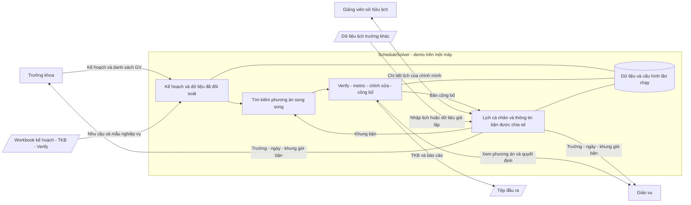

# Bước 2 — Software Glance

**Phiên bản:** 0.1 · **Trạng thái:** Tổng quan khái niệm, chưa phải thiết kế chi tiết.  
**Căn cứ:** [Bối cảnh](00-business-context.md), [Customer Problems](01-customer-problems.md) và các xác nhận trực tiếp về demo một máy, vai trò, workbook và lịch trường khác. Những thông tin ranh giới này đã có nên không phỏng vấn lại.

## Mô tả

ScheduleSolver là công cụ desktop dùng trong demo chuyển vai trò trên một máy, hỗ trợ trưởng khoa chuẩn bị nhu cầu và giáo vụ tạo, đánh giá, sửa rồi công bố TKB các chương trình đào tạo. Kế hoạch mở lớp, điều kiện nguồn lực và giờ bận là dữ liệu đầu vào; lưới `Timetable Spring 2026` và tiêu chí `Verify` là tham chiếu nghiệp vụ cho đầu ra và xem xét. Quá trình tìm kiếm song song cung cấp phương án tốt nhất đã tìm được cùng phần chưa đáp ứng và metric, để giáo vụ giữ quyền quyết định. Giảng viên xem lịch cá nhân tổng hợp nhiều trường, còn người quản lý chỉ biết trường, ngày và khung bận. Dữ liệu kế hoạch, lịch, nguồn giả lập và cấu hình thực nghiệm được lưu để tiếp tục chỉnh sửa, đối chiếu và tái lập với input hiện tại hoặc input mới.

## Sơ đồ ranh giới

Sơ đồ là bản khái niệm bằng Mermaid, không quyết định class, schema, giao thức hoặc cách đồng bộ worker. Các đường thông tin quản lý từ lịch cá nhân chỉ mang dữ liệu đã giới hạn, không mang chi tiết môn/lớp/phòng trường khác.

## Tác nhân và hệ thống ngoài

**Tác nhân:** trưởng khoa cung cấp/chốt nhu cầu; giáo vụ vận hành xếp lịch và quyết định lịch; GV quản lý lịch/giờ bận và xem bản công bố của mình. Demo chọn vai trò và mã GV, không có đăng nhập tài khoản; không coi chuyển vai trò là xác thực danh tính.

**Hệ thống ngoài:** công cụ bảng tính tạo/đọc workbook kế hoạch/TKB/báo cáo; lịch trường khác do GV nhập tay với đủ thông tin. Không bắt buộc nhập/xuất lịch ngoài qua Excel/ICS; chưa có kết nối trực tiếp hệ thống đào tạo, Google Calendar hay Outlook.

## Thành phần ở mức khái niệm

- **Kế hoạch và đối soát:** biểu diễn nhu cầu của từng chương trình, danh tính, tuần học và nguồn dữ liệu.
- **Tìm phương án:** sử dụng dữ liệu/điều kiện để tìm lịch tốt, lưu kết quả tốt nhất trong quá trình chạy song song.
- **Xem xét và công bố:** tập hợp Verify, metric, sửa/khóa và phiên bản lịch giáo vụ đang đánh giá.
- **Lịch cá nhân:** tổng hợp lịch và giờ bận, tách chi tiết riêng khỏi thông tin quản lý được xem.
- **Lưu và thực nghiệm:** giữ input, phiên bản, cấu hình và kết quả phục vụ dùng lại và so sánh.

## Giao diện

| Giao diện | Loại | Kết nối | Mục đích |
|---|---|---|---|
| Không gian trưởng khoa | Cục bộ | Trưởng khoa | Kế hoạch, phân công cho phép, thông tin bận giới hạn |
| Không gian giáo vụ | Cục bộ | Giáo vụ | Xếp lịch, xem Verify/metric, chỉnh sửa và công bố |
| Không gian giảng viên | Cục bộ | GV theo danh tính chọn trong demo | Lịch công bố, chi tiết lịch riêng và giờ bận |
| Nhập/xuất workbook | Tệp | Công cụ bảng tính | Kế hoạch và TKB/báo cáo theo mẫu nghiệp vụ |
| Nhập lịch trường khác | Nhập tay | GV và nguồn lịch | Dữ liệu lịch gộp đầy đủ thông tin; Excel/ICS là mở rộng |
| Lưu/mở và kết quả chạy | Cục bộ | Dữ liệu dự án/thực nghiệm | Giữ phiên bản và căn cứ tái lập |

## Dữ liệu cần lưu

Kế hoạch gốc và đã chuẩn hóa; buổi/lớp/chương trình; danh tính và tập GV đủ điều kiện; bảng ca/lịch theo khóa; tuần rời rạc; phòng có dữ liệu xác nhận; giờ bận/lịch trường khác và nguồn giả lập; phân công nháp, khóa và bản công bố; chính sách Verify, metric, cấu hình thuật toán, seed và kết quả chạy. Khả năng lưu không mất dữ liệu và giới hạn trường thông tin theo vai trò sẽ được đặc tả ở bước FR/NFR; chưa thiết kế schema tại bước này.

## Truy vết

| CP | Phần tổng quan đáp ứng |
|---|---|
| CP.01 | Kế hoạch đã đối soát đi vào quá trình tạo phương án; trả cả phần chưa đáp ứng |
| CP.02 | Không gian giáo vụ với Verify/metric và quyết định công bố |
| CP.03 | Chỉ số chất lượng đi cùng phương án để so sánh các đánh đổi |
| CP.04 | Lịch cá nhân nhiều trường và thông tin bận được giới hạn cho quản lý |
| CP.05 | Dữ liệu/cấu hình/kết quả được lưu cho tái lập và input mới |
| CP.06 | Kế hoạch và đối soát giữ nguồn và ý nghĩa dữ liệu |

**Kiểm tra bước 2:** đã có mô tả, ranh giới, Mermaid, tác nhân/giao diện, thành phần khái niệm, dữ liệu và ánh xạ đủ 6 CP. Chưa suy diễn CN hoặc thiết kế kiến trúc chi tiết. **Tiếp theo:** phỏng vấn Customer Needs để chốt các kết quả người dùng cần nhận.
