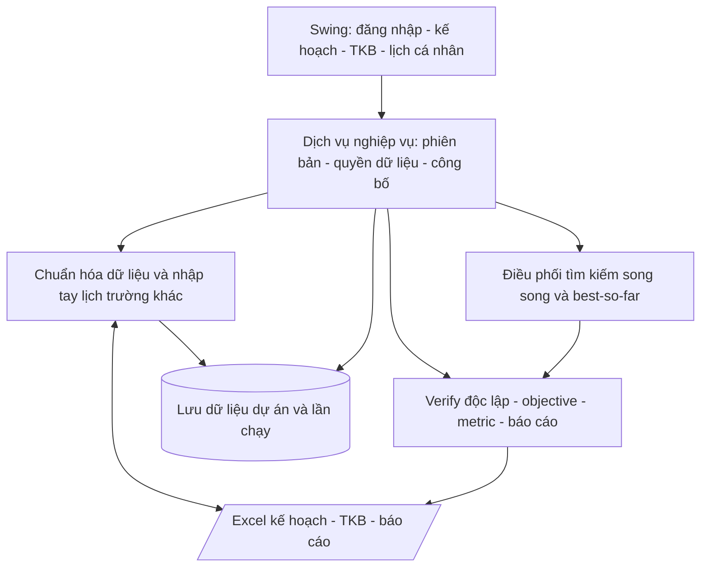

# Bước 4 — Software Vision

**Phiên bản:** 0.1 · **Trạng thái:** Dự thảo để rà soát.  
**Đầu vào:** [Software Glance](02-software-glance.md), [13 Customer Needs](03-customer-needs.md). Hướng triển khai đã được xác nhận qua phỏng vấn: desktop một máy, chọn vai trò, lịch trường khác nhập tay, quy mô theo kế hoạch hiện có; không hỏi lại các quyết định này.

## Positioning

ScheduleSolver phục vụ trưởng khoa, giáo vụ và giảng viên FIT–HANU cần tạo và xem xét TKB nhiều chương trình từ kế hoạch mở lớp. Sản phẩm là ứng dụng desktop hỗ trợ tìm phương án song song, đo chất lượng và hoàn thiện lịch với giáo vụ trong vòng quyết định. So với quy trình Excel thủ công đang được mô tả, giá trị mục tiêu là kiểm tra có truy vết, tìm kiếm có thể tái lập và lịch cá nhân nhiều trường với giới hạn thông tin theo vai trò; các cải thiện định lượng phải được đo, chưa được coi là đã đạt.

## Stakeholders

| Bên liên quan | Vai trò |
|---|---|
| Trưởng khoa | Xác nhận kế hoạch, GV đủ điều kiện và chính sách |
| Giáo vụ | Nhận cả lịch thiếu, xem Verify/metric, xử lý và công bố |
| Giảng viên | Xem chi tiết lịch của mình, nhập lịch trường khác và chia sẻ thông tin bận giới hạn |
| Chủ dự án/người nghiệm thu | Xác nhận phạm vi và đánh giá concurrency, chất lượng, tái lập |
| Nhóm phát triển/bảo trì | Xây dựng, kiểm thử và lưu bằng chứng thực nghiệm; chưa chỉ định đơn vị bảo trì riêng |
| Nguồn Excel và lịch trường khác | Cung cấp dữ liệu; chưa có tích hợp API trực tiếp |
| Sinh viên | Hưởng lợi từ TKB; không có giao diện riêng trong demo |

## Product Overview

**Trong demo:** kế hoạch mở lớp → đối soát → xếp lịch song song → nhận phương án tốt nhất kể cả còn thiếu → xem/chỉnh/khóa → Verify và metric → công bố; lịch gộp nhập tay; TKB trên ứng dụng và Excel kèm báo cáo. **Ngoài demo:** đăng nhập tài khoản, nhập/xuất lịch trường khác bằng ICS/Excel, cộng tác nhiều máy, API đào tạo, web/mobile, lịch thi và đăng ký học phần.

**Thành công:** đầu ra phản ánh đúng kế hoạch và điều kiện, chỉ rõ phần chưa giải; giữ metric hiện có; giới hạn đúng thông tin lịch riêng; có dữ liệu/cấu hình để tái lập và thử input mới; chứng minh nhiều worker tìm kiếm. Quy mô lấy từ dữ liệu đã đối soát; 60 giây là mục tiêu thực nghiệm đề xuất, chưa là cam kết luôn tìm được lịch hợp lệ.

**Chi tiết lịch nhập tay:** đã xác nhận bắt buộc GV sở hữu, trường, môn, lớp, ngày và giờ bắt đầu/kết thúc. Có cơ sở/địa chỉ/phòng được đánh dấu chưa biết; múi giờ phải xác định được; ghi chú và nguồn thực/giả lập. Hỗ trợ buổi đơn hoặc lặp hàng tuần có khoảng hiệu lực và ngày nghỉ ngoại lệ. Không tự bịa phòng/địa chỉ. Xem FR.04.1.1, FR.04.1.2 và [hợp đồng dữ liệu](design/data-contracts.md).

## High-Level Features

| Chức năng | Lợi ích | Ưu tiên | Truy vết |
|---|---|---|---|
| Kế hoạch và đối soát | Đúng tập nhu cầu và nguồn dữ liệu | Must Have | CN.06.1, CN.06.2 |
| Xếp lịch và trả phần chưa đáp ứng | Giáo vụ có phương án để xử lý | Must Have | CN.01.1, CN.01.2 |
| Sửa, giữ cố định và công bố | Giáo vụ kiểm soát lịch chính thức | Must Have | CN.02.2 |
| Verify và báo cáo Excel | Có căn cứ xem xét và bàn giao | Must Have | CN.02.1, CN.02.3 |
| Objective và metric hiện có | So sánh phương án, giải thích đánh đổi | Must Have | CN.03.1, CN.03.2 |
| Tìm kiếm song song, dữ liệu lần chạy | Đáp ứng concurrency và căn cứ thực nghiệm | Must Have | CN.03.2, CN.05.1; ràng buộc BC |
| Lịch gộp nhập tay và thông tin bận giới hạn | Đủ thông tin cá nhân, đúng quyền quản lý | Must Have | CN.04.1, CN.04.2 |
| Lưu phiên bản và xử lý input mới | Tái sử dụng và tái lập | Must Have | CN.05.1, CN.05.2 |

## Environment and Constraints

Demo chạy cục bộ trên một máy. Cập nhật 28/10/2026: có màn hình đăng nhập cho 3 vai trò (DEC.24), mật khẩu lưu dạng băm SHA-256. Đây vẫn chỉ là kiểm soát ở mức giao diện, không phải bảo mật thật. Giới hạn trường dữ liệu theo vai trò vẫn áp dụng trên màn hình và tệp xuất; không tuyên bố bảo vệ khỏi người có quyền truy cập trực tiếp máy/tệp lưu.

Nền tảng (cập nhật 28/10/2026): Java 21, Swing, Maven, POI 5.2.5, lưu bằng CSV và Object Serialization; solver tự viết. Local Search, Simulated Annealing và Tabu Search là hướng đề xuất. Không tự đổi dependency, schema, interface lõi hoặc trọng số. I/O và giải chạy nền; chế độ tái lập và ngân sách thời gian thực cần được phân biệt. Chưa xác nhận hệ điều hành hỗ trợ, bảng giờ/phòng đã đối soát và các ngưỡng phản hồi định lượng.

## High-Level Architecture

Kiến trúc chỉ xác định các khối và luồng chính, chưa thay đổi interface hoặc schema. Chi tiết đồng bộ worker, objective, mô hình dữ liệu và thuật toán thuộc tài liệu thiết kế riêng; FR/NFR mô tả hành vi và chất lượng kiểm chứng được.
